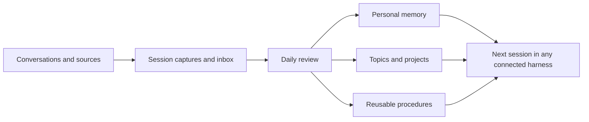

# Shared Memory AI Second Brain

A standalone agent skill that sets up an Obsidian knowledge base, learns how you like to work, and carries useful context between AI tools.

Load [SKILL.md](SKILL.md) into an agent that can read and write files, then say:

> Set up shared memory for me. Ask which shared drive I use, interview me about my work and document preferences, connect the AI tools I use, and schedule a daily review of my sessions.

The agent asks about your preferences and creates your system. You can skip personal questions. No Obsidian plugin, database, embedding service or API key is required for the file tools. An AI harness performs synthesis; its own access and usage limits apply.

## What you get

- A browsable vault with topic overviews, projects, people, decisions and open questions.
- Personal profile, communication preferences, document preferences and a writing-voice procedure grounded in approved feedback and examples.
- An optional separate visible-chat archive and a corpus of your own messages for style calibration; these do not train the underlying model.
- Source and discussion references, exact model/session attribution, and visible unresolved conflicts.
- “Remember this,” “store this,” “correct this,” “forget this,” “what do you know about me?” and “resume” workflows.
- Session captures, a daily synthesis prompt, content-checked review receipts and registered-source catch-up after missed collection days.
- Source/session suppression to keep forgotten evidence out of future helper imports, with separate review of derived notes and external copies.
- Startup files for Codex, Claude Code, Gemini CLI, Cursor and GitHub Copilot, plus a helper to connect additional harnesses to an existing vault.
- A [readiness report](references/readiness.md) that keeps unknown access, scheduling, recall and roaming checks visible.
- Storage choice: OneDrive, Google Drive, another shared drive, or local only, with cross-device verification guidance.



Daily review covers authorized sources the selected runtime can actually access. Local-only conversations, unavailable accounts and incomplete exports remain explicit coverage gaps. Session capture at milestones reduces dependence on proprietary chat-history formats. A shared drive synchronizes files; it does not grant another AI tool access or automatically install a scheduler.

## Install the plugin

For **ChatGPT desktop / Codex**, use the native plugin installer:

```sh
codex plugin marketplace add wissamka/shared-memory
codex plugin add shared-memory@shared-memory
```

For **Claude Code**, run these inside Claude:

```text
/plugin marketplace add wissamka/shared-memory
/plugin install shared-memory@shared-memory
```

Start a fresh session and ask **“Use Shared Memory AI Second Brain to set up my memory.”** In Claude Code you can invoke `/shared-memory:shared-memory`. The agent asks which shared drive you use and guides the setup. You do not need to download or copy skill files yourself.

These install from our public GitHub marketplace. The plugin is not yet listed in the vendors' reviewed public directories. [Installation, updates and removal](references/plugins.md) explains requirements and the separate update of the procedure inside an existing vault.

### Offline / standalone skill installation

Download and extract this repository, or clone it. From that folder, run the interactive installer:

```sh
python3 install.py
```

On Windows use `py install.py`. Choose Codex, Claude Code, both, or a custom skill folder. The script previews the destination, then installs the complete skill after your confirmation. No manual file copying is required.

For a direct installation into both supported default locations:

```sh
python3 install.py --harness codex claude --apply
```

Omit `--apply` to preview only. Use `--target /absolute/path/shared-memory` for another harness's supported skill directory. Codex defaults to `~/.agents/skills/shared-memory`; Claude Code defaults to `~/.claude/skills/shared-memory`. Existing different or edited installations are preserved; identical installation can resume. This installer makes no network calls and installs no dependencies.

Start a fresh agent session and request shared-memory setup (or `/shared-memory` in Claude Code). The agent asks whether you use OneDrive, Google Drive, another service, or local storage only, then resolves the actual location. For an interface without skill discovery, ask it to read the downloaded `SKILL.md` and its bundled files.

Follow [the installation guide](references/installation.md) for a script-driven setup. Python 3.10+ is required for helpers; install the `tzdata` package if the platform has no IANA timezone database. The skill can also guide an agent through equivalent file creation when Python is unavailable, with the same collision and validation checks.

The separate vault bootstrap creates a **new** vault and preserves existing startup instructions. It refuses unrelated nonempty vaults. Existing vaults need a reviewed integration, not an overwrite. Keep the public skill repository and private vault in separate directories. Examples are fictional; configuration, personal captures and generated vaults belong outside this repository.

## Daily review and scheduling

“Dream mode” means an agent reviews accessible sessions, extracts useful knowledge and updates sourced notes. It is a workflow, not a separately installed background process. [Daily review](references/daily-review.md) describes it.

Ask the installing agent to schedule the generated `Automation/Daily review prompt.md` using its supported scheduler. The setup records the actual provider and task ID in `Automation/Schedule.md`. Native scheduling instructions for Codex, Claude and other environments are in [scheduling.md](references/scheduling.md).

The file installer does not silently create an operating-system task, install a model runtime or purchase service usage. A scheduler must have durable access to both the configured session sources and the vault. The helper's `prepare` command creates a review manifest; it does not itself perform LLM synthesis.

Optional [archive and voice calibration](references/voice.md) keep full accessible visible discussion separate from curated memory, then use selected owner-authored messages and approved examples for a style guide. Capture is prospective and scoped; hidden reasoning, tool payloads, secrets and inaccessible history are excluded. An archive containing gaps is reported as partial.

## Examples

> Remember that I prefer a one-page decision brief with evidence links.

> Store this as a proposal for the garden project, not a final decision.

> Review yesterday's sessions and keep unresolved disagreements visible.

> Show me what you know about my document preferences and where each preference came from.

> Forget this preference and stop using it. Tell me where it was stored.

> Check whether memory is ready, including missed source windows and whether the daily job has actually run.

> Keep a separate archive of accessible visible chats and help me approve a style guide based on my own messages.

## Development and verification

```sh
python3 -m unittest discover -s tests -v
python3 scripts/check_package.py
```

Tests use fictional records and temporary directories. They exercise preservation, duplicate capture, failed review receipts, day boundaries and source filtering. They cannot prove a particular user's cloud sync, model quality or scheduler availability. See [acceptance tests](references/acceptance.md) for the live installation checks.

The [verification record](reports/verification.md) documents completed tests. The [completeness audit](reports/completeness-audit.md) and [roadmap](reports/roadmap.md) distinguish implemented work from remaining gates. Automatic canonical-procedure upgrades, full disconnection, and live cloud/scheduler end-to-end evidence remain separate work; test counts alone do not establish those outcomes.

MIT licensed. No private source vault, transcript, personal contact information or credentials are distributed with this package.
