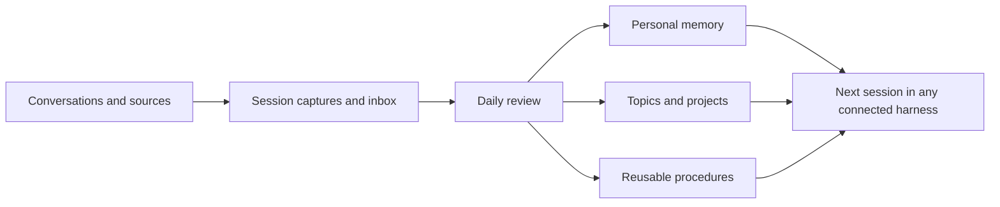

# Shared Memory

A standalone agent skill that sets up an Obsidian knowledge base, learns how you like to work, and carries useful context between AI tools.

Load [SKILL.md](SKILL.md) into an agent that can read and write files, then say:

> Set up shared memory for me. Interview me about my work and document preferences, put the vault in my OneDrive folder, connect the AI tools I use, and schedule a daily review of my sessions.

The agent asks about your preferences and creates your system. You can skip personal questions. No Obsidian plugin, database, embedding service or API key is required for the file tools. An AI harness performs synthesis; its own access and usage limits apply.

## What you get

- A browsable vault with topic overviews, projects, people, decisions and open questions.
- Personal profile, communication preferences, document preferences and a writing-voice procedure grounded in your own feedback.
- Source and discussion references, exact model/session attribution, and visible unresolved conflicts.
- “Remember this,” “store this,” “correct this,” “what do you know about me?” and “resume” workflows.
- Session captures, a daily synthesis prompt, per-input review receipts and missed-run catch-up.
- Startup files for Codex, Claude Code, Gemini CLI, Cursor and GitHub Copilot, plus generic instructions for other interfaces.
- OneDrive setup and cross-device verification guidance.



Daily review covers authorized sources the selected runtime can actually access. Local-only conversations, unavailable accounts and incomplete exports remain explicit coverage gaps. Session capture at milestones reduces dependence on proprietary chat-history formats. OneDrive synchronizes files; it does not grant another AI tool access or automatically install a scheduler.

## Install the skill

Download this repository into a folder named `shared-memory`. Keep the whole folder: the skill uses `references/`, `scripts/` and `assets/`.

- **Codex:** place it in `~/.agents/skills/shared-memory/`, or ask Codex to read this checkout's `SKILL.md`.
- **Claude Code:** place it in `~/.claude/skills/shared-memory/`, then invoke `/shared-memory`.
- **Other agents:** give the agent the folder and ask it to read `SKILL.md`. A Markdown attachment alone is insufficient if its referenced files are unavailable.

Follow [the installation guide](references/installation.md) for a script-driven setup. Python 3.10+ is required for helpers; install the `tzdata` package if the platform has no IANA timezone database. The skill can also guide an agent through equivalent file creation when Python is unavailable, with the same collision and validation checks.

The installer creates a **new** vault and preserves existing startup instructions. It refuses unrelated nonempty vaults. Existing vaults need a reviewed integration, not an overwrite. Keep the public skill repository and private vault in separate directories. Examples are fictional; configuration, personal captures and generated vaults belong outside this repository.

## Daily scheduling

Ask the installing agent to schedule the generated `Automation/Daily review prompt.md` using its supported scheduler. The setup records the actual provider and task ID in `Automation/Schedule.md`. Native scheduling instructions for Codex, Claude and other environments are in [scheduling.md](references/scheduling.md).

The file installer does not silently create an operating-system task, install a model runtime or purchase service usage. A scheduler must have durable access to both the configured session sources and the vault. The helper's `prepare` command creates a review manifest; it does not itself perform LLM synthesis.

## Examples

> Remember that I prefer a one-page decision brief with evidence links.

> Store this as a proposal for the garden project, not a final decision.

> Review yesterday's sessions and keep unresolved disagreements visible.

> Show me what you know about my document preferences and where each preference came from.

> Forget this preference and stop using it. Tell me where it was stored.

## Development and verification

```sh
python3 -m unittest discover -s tests -v
python3 scripts/check_package.py
```

Tests use fictional records and temporary directories. They exercise preservation, duplicate capture, failed review receipts, day boundaries and source filtering. They cannot prove a particular user's cloud sync, model quality or scheduler availability. See [acceptance tests](references/acceptance.md) for the live installation checks.

MIT licensed. No private source vault, transcript, personal contact information or credentials are distributed with this package.
